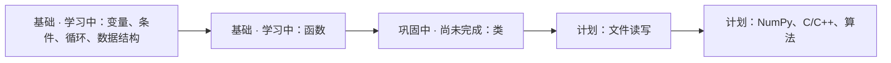

# Python 学习记录

做 AI 产品与工作流的设计型开发者。这是一份 Python 学习记录。

大一，人工智能专业。当前进度：基础学习中；类仍在巩固，尚未完成。

A first-year learning log. Basics are in progress. Classes are still being consolidated.

## 路线

计划保持为计划。尚未写进仓库的练习，不标成已完成。



## 现在有的内容

- [`hello.py`](hello.py)：一行 `print("hello github")`。
- 这份说明：把学习中、巩固中和计划分开写。

## 技术栈

| 项 | 现状 |
| --- | --- |
| 语言 | Python 3 |
| 依赖 | 无第三方包 |
| 测试 | 无 |
| CI | 无 |

## 怎么运行

安装 Python 3，进入仓库目录后执行：

```bash
python3 hello.py
```

期望输出：

```text
hello github
```

当前环境如果没有 `python3` 这个命令，改用 `python hello.py`。

## 现状

「已完成」只对应仓库里已经能运行的 `hello.py`。变量、条件、循环、数据结构、函数仍在基础学习中，仓库里还没有对应练习，不标成已完成。类单独记为巩固中，尚未完成。

| 内容 | 标记 | 本仓库 |
| --- | --- | --- |
| [`hello.py`](hello.py) | 已完成 | 有，可运行 |
| 变量、条件、循环、数据结构 | 基础 · 学习中 | 尚无练习文件 |
| 函数 | 基础 · 学习中 | 尚无练习文件 |
| 类 | 巩固中 · 尚未完成 | 尚无练习文件 |
| 文件读写 | 计划 | 尚无 |
| NumPy | 计划 | 尚无 |
| C / C++ | 计划 | 尚无 |
| 算法 | 计划 | 尚无 |

学习内容目前只有 `hello.py`。2026-11-10 用 Python 3.12.3 执行 `python3 hello.py`，输出为 `hello github`。3.12.3 是这次核对时的环境，其他版本还没有逐一复跑。

## 下一步

- 类继续巩固。结束之前，标记保持为「尚未完成」。
- 计划中的下一项是文件读写。
- 再往后是 NumPy、C/C++ 与算法，同样还是计划。

## 相关项目

这些是另外的仓库。版本和能力以各仓库自己的说明为准。

- [学习搭子 Personal Learning Agent](https://github.com/jjh-python667/personal-learning-agent)（该仓库 README 标为 v0.4.0）· [项目页](https://jjh-python667.github.io/projects/personal-learning-agent.html)
- [星球大战 mini](https://github.com/jjh-python667/star-wars-mini) · [项目页](https://jjh-python667.github.io/projects/star-wars-mini.html)：Python / Pygame 入门练习
- [案头 ANTOU](https://github.com/jjh-python667/antou-office-agent) · [项目页](https://jjh-python667.github.io/projects/antou-office-agent.html)：本地办公 Agent
- [资讯台 Newsdesk](https://github.com/jjh-python667/newsdesk) · [项目页](https://jjh-python667.github.io/projects/newsdesk.html)：Cloudflare Workers + D1 的个人资讯阅读
- [作品集](https://jjh-python667.github.io/)

作者：[jjh-python667](https://github.com/jjh-python667)
